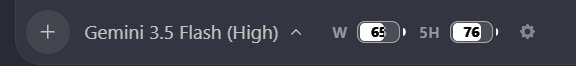

# Antigravity Plus

[English](README.md) | [简体中文](README_zh.md)

A lightweight, zero-dependency Node.js injector suite for **Antigravity 2.0**.

## Modules

| Module | Command | Features |
| --- | --- | --- |
| `limits` | `npm run inject:limits` | Weekly and 5-hour account quota, model-group switching, reset times, hover details, and pill/battery skins. Polls every 5 seconds. |
| `rail` | `npm run inject:rail` | A floating conversation rail with turn titles, response summaries, direct jumps, and current-turn tracking. |
| `font` | `npm run inject:font` | Anthropic Sans / Sarasa UI SC for conversation text and Maple Mono NF for code blocks and Monaco. Fonts are not bundled. |
| `theme` | `npm run inject:theme` | Three warm light presets, composer hover/focus borders, session metrics, settings/zoom workarounds, and hot reload. Runs until stopped. |

The theme adapts [Chuanban v5.0.0](https://github.com/Anarcadia/chuanban-antigravity-theme-patch/tree/b319dba8dcc4f8b5bef38aef810cb530ace192a8) without its translation engine or dictionary. Font families remain controlled by `font`, preserving the current Sans/Sarasa + Maple Mono choice. See [theme/UPSTREAM.md](theme/UPSTREAM.md).

The previous `skills`, three `theme-*` modules, and `enhancements` module have been removed. Select a theme preset through configuration; settings workarounds are now part of `theme`.

## Prerequisites

- Node.js 22 or later. SQLite metrics require a runtime providing `node:sqlite`; Node.js 22.13 or later is recommended. Other theme features work when SQLite is unavailable.
- A running Antigravity 2.0 client with its local CDP debugging port available. No `npm install` is needed.
- Install your chosen fonts separately. Missing fonts use CSS fallback families.

## Usage

Run from the project directory:

```bash
npm run inject                 # Modules enabled in config.json
npm run inject:all             # limits, rail, font, and theme
npm run inject -- --preset claude-desktop-purewhite # Override this run's preset
npm run inject:theme -- --preset vintage-deep      # Theme only, with a preset
node inject.js limits rail     # Only the named modules
node inject.js --no-theme       # Configured modules except theme
node inject.js --safe-mode      # Theme defaults; bypass theme/user customizations
node inject.js --help
```

The default `config.json` enables all four modules:

```json
{
  "limits": true,
  "rail": true,
  "font": true,
  "theme": true
}
```

The runner manages the theme daemon as a child process. Keep the terminal running for automatic theme reconnection and hot reload. `limits` and `rail` are one-shot injectors; rerun them after a client reload if needed. The theme reuses `font`'s CSS on reconnect when that module is selected; standalone font injection remains available.

## Theme configuration

Edit `theme/user/config.json`:

```json
{
  "enabled": true,
  "channel": "auto",
  "preset": "high-contrast",
  "contextLimit": 256000,
  "modules": {
    "metrics": true,
    "composerWaxSeal": true,
    "deadlockHealer": true,
    "customCss": true,
    "customJs": true
  },
  "themeVars": {}
}
```

- Presets: `high-contrast`, `claude-desktop-purewhite`, and `vintage-deep`. All three are light/warm palettes; `vintage-deep` is parchment-colored, not dark mode.
- `--preset <name>` (or `--preset=<name>`) overrides the configured preset for the current process, including during hot reload and safe mode. It does not edit the configuration file. Without this argument, the configured preset is used. The runner requires the `theme` module to be enabled when passing a preset.
- Channels: `auto`, `stable`, or `insiders` for theme target discovery.
- Metrics show generation speed, time to first token, context usage, output tokens, and hover details including cache use and session totals. They read conversation SQLite databases in read-only mode and depend on Antigravity's internal schema. `contextLimit` is configured capacity, not automatic model-capacity detection.
- Add CSS to `theme/user/custom.css`, or set CSS variables such as `--ag-chat-font-size` in `themeVars`.
- Add trusted page-context JavaScript to `theme/user/custom.js`. Register cleanup through `ctx.onDispose(callback)` or return a cleanup function. This is not a security sandbox.

The daemon checks these files every 2.5 seconds. Safe mode bypasses theme user configuration, CSS, and JavaScript; it does not disable other selected injectors.

## Revert

```bash
npm run revert
# Or revert and reload the client window:
node inject.js --revert --reload
```

Revert requests daemon shutdown before removing injected UI, observers, and theme hooks. Reloading alone does not keep the theme disabled while its daemon is running, because it reinjects the theme.

## Optional management commands

Normal injection does not register system startup or install fonts. Run these explicitly when needed:

| Command | Purpose |
| --- | --- |
| `npm run theme:doctor` | Read-only environment, font-file, core-integrity, and CDP diagnostics. |
| `npm run theme:verify` | Read-only injection-marker checks on eligible windows; does not prove visual layout or every feature works. |
| `npm run theme:install` | Back up the core, enable remote debugging in existing client argument directories, and register/start the project runner at login. |
| `npm run theme:install-fonts -- --from "/path/to/fonts"` | Copy supplied fonts into the user's font directory and register them on Windows. |
| `npm run theme:rollback` | Restore a prior core snapshot, preserving `theme/user`. A fresh install may have no prior version. |
| `npm run theme:uninstall` | Remove owned autostart entries, request daemon shutdown, and restore argument files only if unchanged since installation. User files and fonts remain. |

Autostart uses this project's absolute location and `--wait-for-client`: keep the project directory in place. It waits for Antigravity before running the configured modules. Core snapshots and local control state live under `theme/.state/`. Fully restart Antigravity if remote debugging was newly enabled.

## Preview

Existing quota UI previews:




## License

The original Antigravity Plus code is covered by [LICENSE](LICENSE). Adapted theme code has separate provenance; see [theme/UPSTREAM.md](theme/UPSTREAM.md). The root MIT license does not assign a license to that upstream source.
