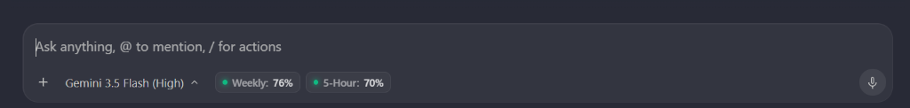
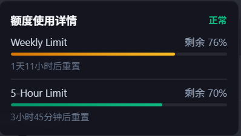

# Antigravity Plus

[English](README.md) | [简体中文](README_zh.md)

A lightweight, zero-dependency Node.js injector suite for **Antigravity 2.0**.

## Modules

| Module | Command | Features |
| --- | --- | --- |
| `limits` | `npm run inject:limits` | Weekly and 5-hour account quota pills, model-group switching, reset times, and hover details. Polls every 5 seconds. |
| `font` | `npm run inject:font` | Anthropic Sans / Sarasa UI SC for conversation text and Maple Mono NF for code blocks and Monaco. Fonts are not bundled. |
| `theme` | `npm run inject:theme` | Three original light presets plus a default warm dark preset, native composer styling, session metrics, settings/zoom workarounds, and one-shot injection. Exits after injection. |

The theme adapts [Chuanban v5.0.0](https://github.com/Anarcadia/chuanban-antigravity-theme-patch/tree/b319dba8dcc4f8b5bef38aef810cb530ace192a8) without its translation engine or dictionary. Font families remain controlled by `font`, preserving the current Sans/Sarasa + Maple Mono choice. See [theme/UPSTREAM.md](theme/UPSTREAM.md).

The previous `rail`, `skills`, three `theme-*` modules, and `enhancements` module have been removed. Antigravity 2.0 natively provides turn rail navigation; select a theme preset through configuration; settings workarounds are now part of `theme`.

## Prerequisites

- Node.js 22 or later. SQLite metrics require a runtime providing `node:sqlite`; Node.js 22.13 or later is recommended. Other theme features work when SQLite is unavailable.
- A running Antigravity 2.0 client with its local CDP debugging port available. No `npm install` is needed.
- Install your chosen fonts separately. Missing fonts use CSS fallback families.

## Usage

Run from the project directory:

```bash
npm run inject                 # Modules enabled in config.json
npm run inject:all             # limits, font, and theme
npm run inject -- --preset claude-desktop-purewhite # Override this run's preset
npm run inject:theme -- --preset high-contrast-dark # Theme only, in warm dark colors
node inject.js limits font     # Only the named modules
node inject.js --no-theme       # Configured modules except theme
node inject.js --safe-mode      # Theme defaults; bypass theme/user customizations
node inject.js --help
```

The default `config.json` enables all three modules:

```json
{
  "limits": true,
  "font": true,
  "theme": true
}
```

UI injection runs once and the runner exits. Quotas poll in the page; a hidden Context worker checks database changes every 2.5 seconds. It neither watches theme files nor re-injects UI, and exits after all client windows have been absent for about 7.5 seconds. Re-running replaces the old worker; logs are in `theme/.state/metrics.log`. On Windows, if the stop handshake exceeds 10 seconds, the runner checks the recorded PID's creation time and command line, clears stale records, and terminates only a verified worker from this workspace. If identity cannot be verified, it reports an error and leaves the process running. Re-inject after client reloads or configuration edits. On Windows, `start-antigravity.bat` launches the default installation, waits for a fully loaded document with a title and rendered workbench components, and injects the configured modules. Empty localhost bootstrap pages remain pending. The launcher removes inherited `ELECTRON_RUN_AS_NODE` from the client process environment so launches from Electron-based terminals open the application normally. Theme injection waits up to 30 seconds if the workbench disappears during startup; the Context worker allows a 5-second startup gap. Node.js and an enabled local CDP port are required.

## Theme configuration

Edit `theme/user/config.json`:

```json
{
  "enabled": true,
  "channel": "auto",
  "preset": "high-contrast-dark",
  "contextLimit": 256000,
  "modules": {
    "metrics": true,
    "deadlockHealer": true,
    "customCss": true,
    "customJs": true
  },
  "themeVars": {}
}
```

- Presets: `high-contrast-dark` is the default warm charcoal preset. The original `high-contrast` (warm high-contrast white), `claude-desktop-purewhite` (pure white), and `vintage-deep` (light parchment) remain available with their original colors. The dark preset covers the sidebar, menus, metrics, and quota panel without changing native theme settings. The composer uses native styling and layout, retaining native surface and matching text colors captured before injection; its custom borders, shadows, button colors, typography, and voice-state overrides have been removed. Switch presets or revert injection to remove dark styles.
- `--preset <name>` (or `--preset=<name>`) overrides the configured preset for the current process, including during hot reload and safe mode. It does not edit the configuration file. Without this argument, the configured preset is used. The runner requires the `theme` module to be enabled when passing a preset.
- Channels: `auto`, `stable`, or `insiders` for theme target discovery.
- Metrics show generation speed, time to first token, context usage, output tokens, and hover details including cache use and session totals. They read conversation SQLite databases in read-only mode and depend on Antigravity's internal schema. `contextLimit` is configured capacity, not automatic model-capacity detection.
- Add CSS to `theme/user/custom.css`, or set CSS variables such as `--ag-chat-font-size` in `themeVars`.
- Add trusted page-context JavaScript to `theme/user/custom.js`. Register cleanup through `ctx.onDispose(callback)` or return a cleanup function. This is not a security sandbox.

Re-run injection after editing these files. Safe mode bypasses theme user configuration, CSS, and JavaScript; it does not disable other selected injectors.

The legacy `composerWaxSeal` setting is still accepted for compatibility but no longer changes composer styling.

## Revert

```bash
npm run revert
# Or revert and reload the client window:
node inject.js --revert --reload
```

Revert stops any older managed daemon before removing injected UI, observers, and theme hooks. A client reload also clears one-shot injections.

## Optional management commands

Normal injection does not register system startup or install fonts. Run these explicitly when needed:

| Command | Purpose |
| --- | --- |
| `npm run theme:doctor` | Read-only environment, font-file, core-integrity, and CDP diagnostics. |
| `npm run theme:verify` | Read-only injection-marker checks on eligible windows; does not prove visual layout or every feature works. |
| `npm run theme:install` | Back up the core, enable remote debugging in existing client argument directories, and register/start the project runner at login. |
| `npm run theme:install-fonts -- --from "/path/to/fonts"` | Copy supplied fonts into the user's font directory and register them on Windows. |
| `npm run theme:rollback` | Restore a prior core snapshot, preserving `theme/user`. A fresh install may have no prior version. |
| `npm run theme:uninstall` | Remove owned autostart entries, request daemon shutdown, and restore argument files only if unchanged since installation. User files and fonts remain. |

Autostart uses this project's absolute location and `--wait-for-client`: keep the project directory in place. It waits for Antigravity before running the configured modules. Core snapshots and local control state live under `theme/.state/`. Fully restart Antigravity if remote debugging was newly enabled.

## Preview

Existing quota UI previews:




## License

The original Antigravity Plus code is covered by [LICENSE](LICENSE). Adapted theme code has separate provenance; see [theme/UPSTREAM.md](theme/UPSTREAM.md). The root MIT license does not assign a license to that upstream source.
