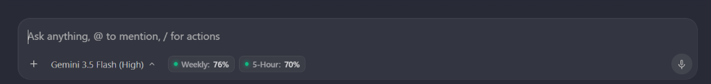
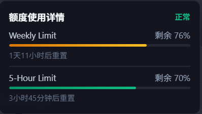

# Antigravity Plus

[English](README.md) | [简体中文](README_zh.md)

一个用于 **Antigravity 2.0** 的轻量、零依赖 Node.js 界面注入套件。

## 功能模块

| 模块 | 命令 | 功能 |
| --- | --- | --- |
| `limits` | `npm run inject:limits` | 账号周额度和 5 小时额度胶囊、模型组切换、重置时间及悬浮详情，每 5 秒查询。 |
| `font` | `npm run inject:font` | 对话正文使用 Anthropic Sans／Sarasa UI SC，代码块和 Monaco 使用 Maple Mono NF，不附带字体文件。 |
| `theme` | `npm run inject:theme` | 三套暖色浅色主题、输入框悬停／聚焦边框、会话性能指标、设置及缩放修复、一次性注入，完成后退出。 |

主题模块基于[船板 v5.0.0](https://github.com/Anarcadia/chuanban-antigravity-theme-patch/tree/b319dba8dcc4f8b5bef38aef810cb530ace192a8) 改编，不包含汉化引擎或词典。字体仍由 `font` 模块负责，保留当前 Sans／Sarasa + Maple Mono 方案。来源与署名见 [theme/UPSTREAM.md](theme/UPSTREAM.md)。

旧 `rail`、`skills`、三个 `theme-*` 模块及 `enhancements` 模块已移除。Antigravity 2.0 已原生支持对话轮次导航；主题预设统一通过配置选择，设置修复并入 `theme`。

## 前提条件

- Node.js 22 或更高版本。会话指标需要运行时提供 `node:sqlite`，推荐 Node.js 22.13 或更高版本；SQLite 不可用时，其余主题功能仍可运行。
- 正在运行的 Antigravity 2.0 客户端，且本地 CDP 调试端口可连接。无需执行 `npm install`。
- 所需字体另行安装；缺失时使用 CSS 中的后备字体。

## 使用方法

在项目目录运行：

```bash
npm run inject                 # 按 config.json 启用模块
npm run inject:all             # 启用 limits、font、theme
npm run inject -- --preset claude-desktop-purewhite # 本次使用净白主题
npm run inject:theme -- --preset vintage-deep      # 单独启动羊皮纸主题
node inject.js limits font     # 仅启用指定模块
node inject.js --no-theme       # 按配置运行，但关闭 theme
node inject.js --safe-mode      # 主题使用默认配置，跳过 theme/user 定制
node inject.js --help
```

默认 `config.json` 启用三个模块：

```json
{
  "limits": true,
  "font": true,
  "theme": true
}
```

界面一次性注入，完成后运行器退出。额度提示在页面内每 5 秒刷新；Context 由隐藏的后台进程每 2.5 秒检查数据库变化并更新。后台进程不监听主题文件、不重新注入界面；客户端所有窗口关闭约 7.5 秒后自动退出。重复运行会替换旧进程，日志位于 `theme/.state/metrics.log`。修改主题配置或定制文件、刷新或重启客户端后，需要重新注入。

Windows 双击 `start-antigravity.bat`，即可启动 `%LOCALAPPDATA%\Programs\Antigravity\Antigravity.exe`，等待窗口就绪，再按 `config.json` 注入。失败时窗口保留错误信息。需要已安装 Node.js，且客户端已开启本地 CDP 调试端口。

## 主题配置

编辑 `theme/user/config.json`：

```json
{
  "enabled": true,
  "channel": "auto",
  "preset": "high-contrast",
  "contextLimit": 256000,
  "modules": {
    "metrics": true,
    "composerWaxSeal": true,
    "deadlockHealer": true,
    "customCss": true,
    "customJs": true
  },
  "themeVars": {}
}
```

- 预设：`high-contrast`、`claude-desktop-purewhite`、`vintage-deep`。三套均为浅色暖纸配色，`vintage-deep` 是羊皮纸色，不是深色模式。
- `--preset <名称>`（或 `--preset=<名称>`）优先于配置中的预设，且在本次进程的热重载和安全模式中保持生效，不会改写配置文件。未传参数时使用配置中的预设；通过统一运行器传入时，需要启用 `theme` 模块。
- 通道：`auto`、`stable` 或 `insiders`，用于主题窗口发现。
- 指标显示生成速度、首字耗时、上下文用量及输出 Token；悬浮详情包含缓存使用和会话累计数据。指标只读访问本地会话 SQLite 数据库，依赖 Antigravity 的内部格式。`contextLimit` 是手动配置的容量，不会自动识别模型上限。
- 在 `theme/user/custom.css` 追加 CSS，也可在 `themeVars` 中配置 `--ag-chat-font-size` 等变量。
- 在 `theme/user/custom.js` 编写受信任的页面脚本；使用 `ctx.onDispose(callback)` 或返回清理函数，以支持热重载和撤销。该扩展不提供安全沙箱。

修改文件后需重新注入。安全模式跳过主题用户配置、CSS 和 JavaScript，不会关闭其他已选注入模块。

## 撤销注入

```bash
npm run revert
# 或撤销后重载客户端窗口：
node inject.js --revert --reload
```

撤销会先请求旧主题守护进程退出，再清理注入的界面、观察器和主题钩子。重新加载客户端窗口也会清除一次性注入。

## 可选管理命令

普通注入不会注册系统自启或安装字体，需要时显式执行：

| 命令 | 用途 |
| --- | --- |
| `npm run theme:doctor` | 只读检查运行环境、字体文件、内核完整性及 CDP 状态。 |
| `npm run theme:verify` | 只读检查符合条件窗口中的注入标记，不能代替视觉布局和各项功能验收。 |
| `npm run theme:install` | 备份主题内核，在已有客户端参数目录中启用远程调试，并注册、启动项目运行器的登录自启。 |
| `npm run theme:install-fonts -- --from "字体目录"` | 将用户提供的字体复制到用户字体目录，并在 Windows 注册。 |
| `npm run theme:rollback` | 恢复上一份内核快照，保留 `theme/user`；首次安装不保证存在可回滚的旧版本。 |
| `npm run theme:uninstall` | 移除本项目自启项、请求守护进程退出；参数文件仅在安装后未被修改时恢复。保留用户文件及已安装字体。 |

自启使用当前项目的绝对路径和 `--wait-for-client` 参数，请保留项目目录。运行器会等待 Antigravity 启动后再注入配置中的模块。内核快照及本地控制状态保存在 `theme/.state/`。首次开启远程调试后，需要完全退出并重新打开 Antigravity。

## 效果预览

现有额度界面示例：




## 许可与来源

Antigravity Plus 原有代码适用根目录的 [LICENSE](LICENSE)。改编的上游主题代码来源见 [theme/UPSTREAM.md](theme/UPSTREAM.md)，根目录 MIT 许可不代表对该上游代码另行授予许可。
