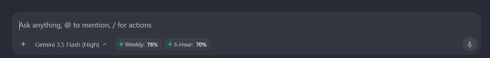
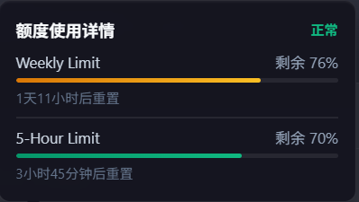
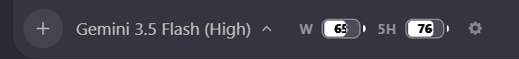

# Antigravity Plus

[English](README.md) | [简体中文](README_zh.md)

一个轻量、零依赖的 Node.js 脚本套件，用于为 **Antigravity 2.0** 桌面客户端提供界面自定义与效率增强功能。

---

## 📸 效果预览

### 1. 输入框额度提示标签


### 2. 鼠标悬停详细卡片


### 3. 数字电池皮肤 (皮肤管理器)


---

## ✨ 核心特性与模块

### 1. 额度状态指示器 (`npm run inject:limits`)
* **水平布局对齐**：限额标签与原版模型选择器在同一水平线上并排展示，完美融入原生 UI，保持界面整洁，不会产生换行。
* **真实数据同步**：安全提取本地 `csrfToken`，每 5 秒自动轮询后台的 gRPC 服务接口（`RetrieveUserQuotaSummary`），显示您账号下真实的用量百分比。
* **模型分组自动切换**：支持 Gemini 模型组与第三方模型组（如 Claude / GPT）的额度自动识别切换。当您在客户端中切换模型时，额度标签及卡片中的详情会自动变更为对应分组的数据。
* **发光状态灯 (Status Dot)**：胶囊状态点颜色会随着您的剩余额度动态发生变化（剩余 >50% 为绿色 safe，20%~50% 为黄色 warning，<20% 为红色 danger）。
* **平滑悬浮详情面板 (Tooltip Card)**：鼠标悬停在额度标签上时，会淡入滑出一个毛玻璃卡片，显示已用/剩余百分比进度条，以及下一次额度重置的刷新时间倒计时。
* **皮肤管理器**：支持胶囊标签与数字电池皮肤切换，并自适应深色/浅色主题。

### 2. 技能管理器 (`npm run inject:skills`)
* **可视化技能管理**：向 Antigravity 界面注入可视化技能选择与查看面板。
* **本地守护服务**：内置运行于 `9527` 端口的轻量本地代理服务，自动解析与管理全局技能。

### 3. 轮次导航轨 (`npm run inject:rail`)
* **长对话快速导航**：在对话视图左侧注入浮动导航轨。
* **一键跳转**：轻松在长对话中的各轮次提问与回答间精确定位与跳转。

### 4. 自定义字体美化 (`npm run inject:font`)
* **界面排版优化**：注入字体样式，将 AI 输出消息的中文字体替换为 `MiSans`，代码块字体替换为 `Maple Mono NF`。

---

## 🛠️ 前提条件

* **Node.js v22.0.0 或更高版本**：由于脚本使用了原生全局的 `WebSocket` 和 `fetch` 接口以保证轻量与安全，因此需要 Node.js v22+ 运行环境（无需安装任何额外的 npm 依赖包）。
* **正在运行的 Antigravity 2.0 客户端**。

---

## 🚀 使用方法

1. 启动您的 **Antigravity 2.0** 客户端。
2. 在此项目根目录下打开终端，执行对应模块命令即可：

```bash
# 注入额度指示器 (默认)
npm run inject:limits

# 注入技能管理器界面与本地服务
npm run inject:skills

# 注入对话轮次导航轨
npm run inject:rail

# 注入自定义字体样式
npm run inject:font
```

3. 脚本运行后会自动通过 `DevToolsActivePort` 嗅探客户端调试端口，并将对应组件热注入到您的 Antigravity 客户端窗口中。

---

## 📂 项目结构

* `inject-limits.js`：额度指示器与皮肤管理器。
* `inject-skills.js`：技能管理器 UI 与本地代理服务。
* `inject-turn-rail.js`：对话轮次导航轨注入脚本。
* `inject-font.js`：自定义字体美化注入脚本。
* `package.json`：项目元数据与 npm scripts。
* `CHANGELOG.md`：版本变更记录。
* `.gitignore`：Git 忽略配置。
* `LICENSE`：MIT 开源协议。

---

## 📄 开源协议

本项目基于 [MIT License](LICENSE) 协议开源。
